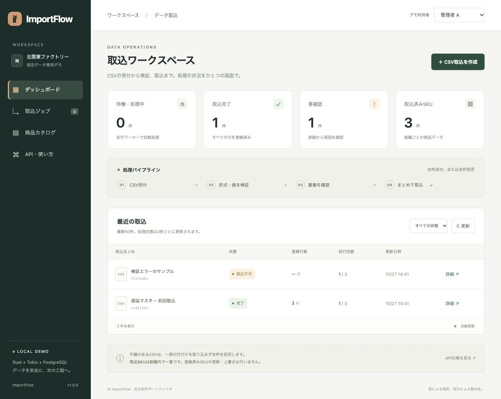

# ImportFlow v1.0.1 — Rust非同期データ取込ポートフォリオ

製造部品CSVの受付・検証・一括取込を管理する自主制作です。不正行があるCSVを全件拒否し、取込の重複・取消・処理期限切れを、複数ワーカーと実際のPostgreSQLで扱います。



## 起動

Docker Desktopを起動し、このREADMEがあるフォルダーで実行します。

```sh
docker compose up --build -d app
```

http://localhost:8080 を開いてください。初回のビルドには数分かかります。既に8080を使用している場合はcompose.yamlのホスト側ポートを変更してください。架空CSVが自動投入され、数秒で「完了1件」「要確認1件」「取込済み3 SKU」になります。

```sh
docker compose logs -f app
docker compose down
```

停止後もDBの名前付きボリュームに保持します。`down -v`はデータも削除するため、通常の停止では不要です。

## 3分で試す

1. 「CSV取込を作成」でサンプルを登録する。
2. 「模擬的な一時障害」を2回に設定し、3回目に回復する操作履歴を確認する。
3. 不正な数量のCSV、登録済みSKUを含むCSVで「全件拒否」を確認する。
4. 商品カタログで登録内容を確認する。
5. 閲覧担当・別組織へ切り替え、操作権限とデータ分離を確認する。

[詳しい操作手順](docs/DEMO.md)。データは架空の部品のみを使用してください。

## 技術・設計

| 項目 | 実装 |
| --- | --- |
| 言語・API | Rust 1.99.1、Axum 0.8.9、serde、REST / OpenAPI 3.0.3 |
| 非同期処理 | Tokio、2ワーカー、spawn_blocking、30秒リース、古い結果の排除 |
| DB | PostgreSQL 17、SQLx 0.8.6、取引・一意制約・SKIP LOCKED |
| 型の境界 | 非公開内部のValidatedBatch、Result、列挙型エラー、unsafe禁止 |
| GraphQL | async-graphql 7.2.1、認証付き読取、深さ・複雑度制限 |
| 管理画面 | React 19、TypeScript、応答世代管理、BigIntでの金額表示 |
| 品質 | fmt / clippy / cargo test / proptest / cargo-audit / npm audit |
| 配布・運用 | Docker Compose、非root、JSONログ、ヘルス、GitHub Actions定義 |

## デモ認証

| 公開デモキー | 役割 | 組織 |
| --- | --- | --- |
| demo-manager-a | 管理者 | factory-a |
| demo-operator-a | 操作担当 | factory-a |
| demo-viewer-a | 閲覧のみ | factory-a |
| demo-manager-b | 別組織の管理者 | factory-b |

画面右上で切り替えられます。APIは`Authorization: Bearer キー`を使用します。本番の利用者認証・秘密鍵管理ではありません。

API仕様: http://localhost:8080/openapi.json

## 検証

```sh
docker compose --profile test run --build --rm tests
```

実PostgreSQLが必須です。環境変数がない統合試験をskipして成功扱いする構成にはしていません。ビルド時に画面の型検査・テストも実行します。

Rustの27件（単体・プロパティ9件、実DB統合18件）、画面側4件の試験を実施。fmtと警告をエラーにしたclippyを通過しています。実施ログと範囲は[検証報告書](docs/VALIDATION.md)に記録しています。

**監査の例外:** Cargo.lockには未使用のSQLx MySQL経由の`rsa`についてRUSTSEC-2023-0071が1件あります。通常の全件監査結果を同梱し、実際の選択ビルド経路にrsaが含まれないことを確認して、この1件だけを条件付きで除外します。rsaが使われる構成へ変わると検査は失敗します。全指摘が0件との主張ではありません。

## 資料

- [Rust案件の要求スキル調査](docs/RESEARCH.md)
- [要求と実装の対応表](docs/REQUIREMENTS_MATRIX.md)
- [設計と保証の範囲](docs/DESIGN.md)
- [クラウド構成の検討](docs/CLOUD.md)
- [完成範囲・制約](docs/LIMITATIONS.md)
- [応募時の紹介例](docs/PORTFOLIO.md)
- [Claudeへの反証レビュー依頼手順](docs/COUNTER_REVIEW.md)

ローカルの自主制作であり、Rust実務年数、受託納品、クラウド・外部MQの本番運用経験を示す作品ではありません。公開先と自動テストの実行結果は下記リンクから確認できます。作品固有のライセンス条件は未指定、依存ソフトウェアには個別のライセンスが適用されます。

## 一次審査の指摘改修

利用者切替後の旧組織再表示と、期限切れ整理の行ロックによる取得停滞をv1.0.1で改修しました。[改修・再検証報告](docs/REVISION_1_0_1.md)を参照してください。

## 公開先

https://github.com/no-dev-portfolio/importflow-rust-portfolio

[GitHub Actions](https://github.com/no-dev-portfolio/importflow-rust-portfolio/actions)
