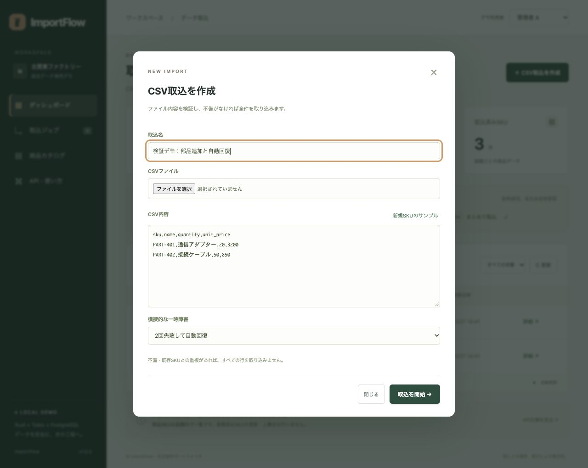
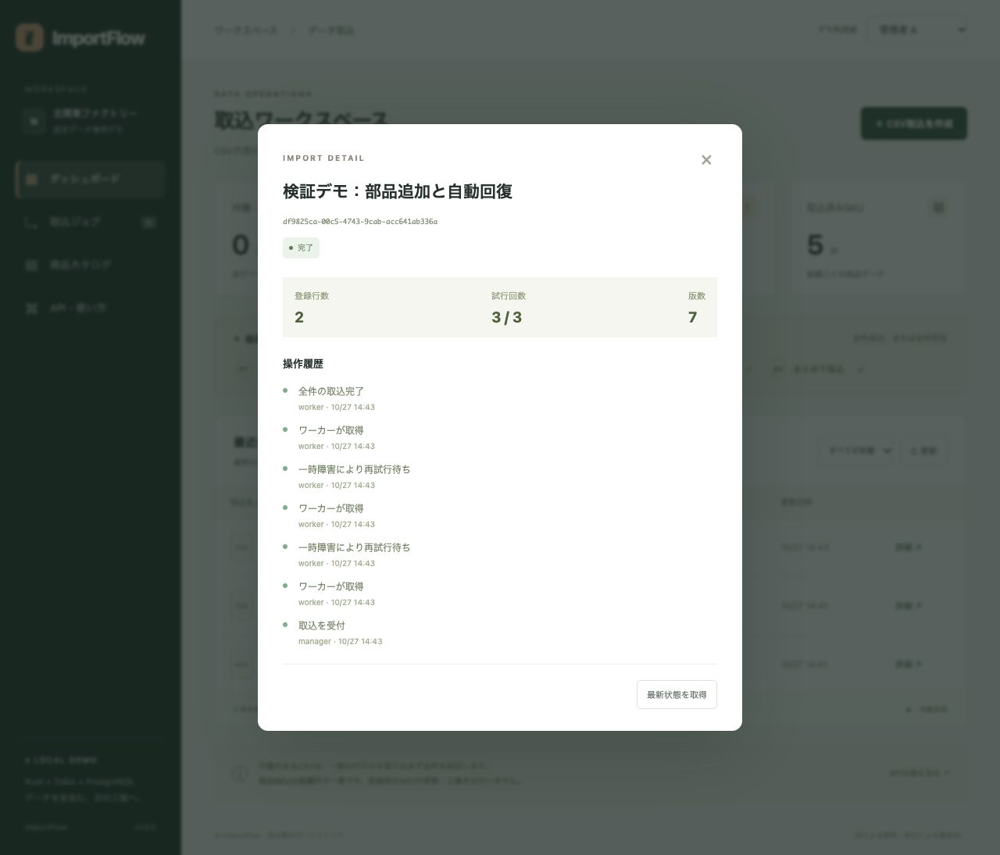
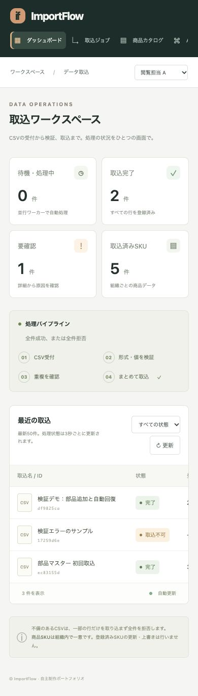

# デモ手順

## 初期状態

READMEに従って起動し、http://localhost:8080 を開きます。最初の数秒でワーカーが2件の架空CSVを処理し、完了1件・取込不可1件・商品3件になります。既存ボリュームには重複投入しないため、操作後の件数は異なります。

## 取込と自動回復

1. 管理者Aで「CSV取込を作成」を開く。
2. 取込名を入力する。必要なら「新規SKUのサンプル」で重複しないデータを用意する。
3. 「模擬的な一時障害」で「2回失敗して自動回復」を選ぶ。
4. 「取込を開始」を押す。待機→処理→待機を経て完了する。
5. 取込名を押して詳細を開く。登録2行、試行3/3と、受付・取得・再試行待ち・完了の履歴を確認する。





詳細画面は自動更新しません。「最新状態を取得」を押すと最新の状態・履歴を読みます。一覧と集計は約3秒で更新します。

## 不正CSV・重複

数量を`-1`または`1.5`にしたCSVを新しい取込として送ります。受付後、ワーカーが検証して取込不可にします。有効な行を混ぜても商品カタログへ一部だけ登録しません。

同じSKUのCSVを新しい要求キーで再送すると、既存SKUの重複として全件拒否します。既存データは上書きしません。修正版は新しい取込として登録してください。

## 取消・権限

模擬障害を設定した取込の待機中に詳細を開き、「取込を取消」を押します。既に完了した場合には取消できません。処理速度によって操作タイミングが変わるため、厳密な競合の確認は自動試験で行います。

右上で閲覧担当Aにすると作成ボタンが消えます。管理者BにするとAのジョブ・商品は表示されません。API側も同じ制限を強制します。

## APIと再送

RESTの作成は`POST /api/jobs`、JSONはlabel/csv/simulate_failures、ヘッダーに8〜80文字の`Idempotency-Key`を指定します。通信結果が不明な場合は同じキー・同じ内容で再送すると同じジョブを取得できます。別内容への変更は409です。

GraphQLは`POST /api/graphql`へ以下をJSONで送ります。認証はRESTと同じです。

```json
{"query":"{ jobs(limit: 20) { id label status attempts rowCount version } }"}
```

変更系mutationは用意していません。読取専用の型付きAPIです。


