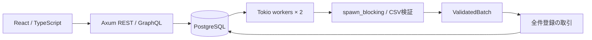
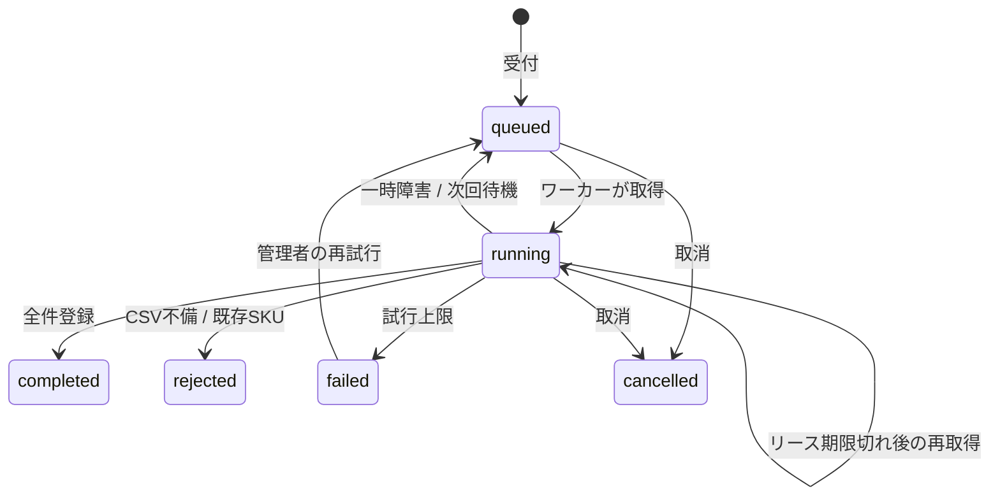

# ImportFlowの設計

## 対象業務

架空の製造部品マスターをCSVで一括追加する。取込前の検証と、既存データとの重複検査を行い、全件成功または全件拒否とする。在庫の実在庫更新・発注・決済・外部配送は行わない。

## Rustで表す境界

- `Submission`はserdeで未知項目を拒否し、取込名・CSVサイズ・模擬障害値を正規化する。
- CSV検証は`Result<ValidatedBatch, Vec<Issue>>`を返す。ValidatedBatchの内部Vecは非公開で、読み取り専用の参照のみ公開する。未検証のProduct列をそのまま完了処理へ渡すAPIにはしない。
- `Fault`は入力・認証・認可・状態競合・キュー上限・DB失敗を列挙し、HTTPへ変換する。
- アプリ全体に`forbid(unsafe_code)`を指定。依存ライブラリまでunsafeがないと主張するものではない。
- SQLxのPoolをクローンして共有し、長寿命の可変グローバル状態・アプリ内全体MutexでDB整合性を代用しない。

## データと状態

`jobs`に入力・状態・試行回数・version・リーストークン・処理期限を保持。`catalog`は組織+SKUの一意制約、組織+job_idの外部キーを持つ。`audit`は受付・取得・結果・操作の履歴。成功・拒否・取消の書込と履歴は同じトランザクション。

同じ要求キー・同じ正規化入力の再送は、同じジョブの現在状態を返す。rejectedのCSVを修正した場合は新しい要求キーで作成する。確定済みキーの内容を変えると409。

## 受付と上限

組織単位のトランザクションadvisory lockで要求キー確認・待機件数確認・受付を直列化する。queued/runningは組織内20件まで。再試行の再受付にも同じ上限を適用する。

入力はJSON全体1MiB、CSV最大512KiB、明細最大1,000件。キュー上限はメモリや永続データ全体の無制限成長を防ぐ仕組みではない。終状態のデータ保管・削除ポリシーは未実装。

## 並行ワーカーと処理期限

ワーカー数は2。各ワーカーは1件の検証・取込が終わってから次の件を取る。CPU処理をTokioのI/O実行スレッド上で長時間行わず、spawn_blockingへ移す。同時のCSV検証はワーカー数により2件に制限される。

取得は`FOR UPDATE SKIP LOCKED`で競合するワーカーを分離し、新しいUUIDトークンと30秒のリースを発行。最大試行回数3回。リース期限が切れたrunningは再取得でき、3回使い切った期限切れはfailedになる。整理対象もFOR UPDATE SKIP LOCKEDで1回最大50件に制限し、他の取引が保持する行を待たずに残りの待機ジョブを取得する。整理と監査記録は同じ取引で行う。

結果の保存は、ジョブ行ロック・running状態・同一トークン・DB時計での期限確認が必要。全ての商品行を処理した後も期限を再確認する。取消や別ワーカーによる再取得後の古い結果は書かない。期限超過時に取引を確定せず、途中の商品挿入もロールバックする。

保証の判定点は必要な行ロック取得後のDB時計確認時点。厳密なコミット時刻・応答到着時刻を期限の基準とする保証ではない。リース更新はしないため、処理が長引いたジョブは回復処理へ回る。

模擬障害時は1秒・2秒の待機を経て再試行。設定0〜2回では最終的に3回以内に回復する。実際の外部API障害を再現したものではない。

## 全件拒否

入力CSV内で重複SKUを検出。正当な行はSKU順に整列して同じ順にDBの一意制約へアクセスする。既存SKUが1件でもあればsavepointへ戻し、その取込で追加した行をすべて取り消した後、rejectedと履歴を保存する。既存商品は上書きしない。

商品単価と数量は整数。数量1〜100,000、単価0〜100,000,000円。DBの合計は整数・numericで計算し、集計値は10進文字列で返す。画面はBigIntで表示し、Numberの精度上限を越えた金額を丸めない。

## 認証・API・運用

固定Bearerキーはローカルデモ専用。認証から組織を決定し、REST・GraphQL・履歴・メトリクスを同じ組織で絞り込む。manager/operatorは受付・取消可、failedの再試行とmetricsはmanagerのみ。viewerは読取のみ。

RESTで変更系を集約。GraphQLはjobsの型付き読取のみ、limit1〜50、depth4、complexity100、query4KiB上限。GraphQLの検証エラーは200とerrorsを返す。API一覧はlimit1〜100・offset0〜10000、画面は先頭50件を表示。

DB接続最大10、取得待ち5秒、statement timeout5秒・lock timeout4秒。HTTP要求処理の上限10秒。終了時にHTTPを停止してワーカーを止め、DBプールを閉じる。依存ドライバ・OSに起因する全ての停止時間を保証するものではない。

JSONログには要求ID・メソッド・テンプレート経路・状態・所要時間を記録し、認証キー・本文・CSVは出さない。セキュリティヘッダー、同一オリジンの画面、認証後no-storeを使用。healthはLISTEN_ADDRのポート・IPファミリーに追随する。

## 画面の応答

読取要求は世代とAbortControllerで古い応答を無効化する。詳細履歴も別世代を持つ。利用者切替では前の組織のデータを消し、変更応答も無効化する。現在のtokenと利用者世代を読取開始前・反映前に照合し、古い処理が新しい利用者の読取世代を上書きしない。変更後の詳細取得をawaitした後も利用者世代を再確認する。作成結果が不明な通信失敗は同じ内容・要求キーを保持して再送。明確な入力拒否等では編集を再開できる。ページ再読込・利用者切替を越える再送記録の永続保存はしない。
